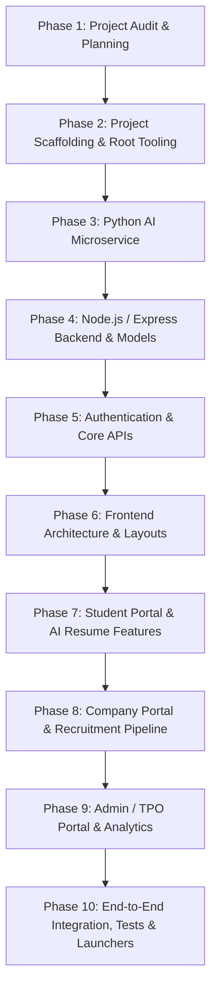

# College Placement Portal - Project Audit & Architecture Plan

**Date:** November 2026  
**Auditor:** Lead Full-Stack & AI Systems Architect  
**Workspace:** `C:\Users\manik\Downloads\mern pro`  

---

## 1. Executive Summary

A comprehensive scan and environment inspection of the project workspace was conducted. The workspace directory `mern pro` is an uninitialized/empty workspace targeted for the complete build of the **AI-Powered College Placement Portal**. 

The system environment includes:
- **Node.js:** `v24.21.0`
- **npm:** `11.19.0`
- **Python:** `3.14.6` with pip, scikit-learn, numpy, pandas, and FastAPI / Uvicorn / PyMuPDF ecosystem.
- **Git:** `2.56.0`

Because the workspace contains no legacy code files, we have a clean slate to implement the entire modular architecture according to the strict enterprise specification, without technical debt or breaking changes to working assets.

---

## 2. Existing Workspace Audit

| Component | Status | Finding | Action Required |
|-----------|--------|---------|-----------------|
| **Root Directory** | Empty | No `package.json`, `start.bat`, `stop.bat`, or `index.html` | Initialize root project files, batch launcher, process manager, and documentation. |
| **Backend Directory** | Missing | No Express server, routes, models, or DB configuration | Scaffold Express MVC server, MongoDB Atlas connection, Mongoose models, JWT auth, Multer uploaders, and APIs. |
| **Frontend Directory** | Missing | No React/Vite/Tailwind frontend | Build production-ready Vite + React 18 + Tailwind CSS frontend with Lucide icons, Recharts, Framer Motion, and complete user interfaces. |
| **AI Service Directory**| Missing | No FastAPI / Python NLP service | Build FastAPI microservice using PyMuPDF, scikit-learn (TF-IDF + Cosine Similarity), NLP skill extraction, rubric scoring, and recommendation engine. |
| **Database Config** | Missing | No `.env` or MongoDB Atlas config | Provide `.env.example`, `.env` template, resilient Mongoose connection handler with offline mock/fallback support for continuous execution. |

---

## 3. Required Feature Set & Gap Analysis

### A. Authentication & Authorization
- **Missing:**
  - Student registration with academic details (CGPA, Roll No, Dept, Year, Phone).
  - Company registration with verification workflow (Official Email, Website, Industry, Location).
  - Secure Admin authentication (protected credential setup / seed script).
  - JWT token generation, role verification middleware (`authMiddleware.js`, `roleMiddleware.js`), password hashing via bcryptjs.

### B. Student Module
- **Missing:**
  - Student dashboard with summary cards (CGPA, available jobs, applications, shortlisted, interviews, notifications).
  - Full profile management (Personal, Academics, Skills, Projects, Certifications, Internships, Resume upload, Avatar).
  - Job exploration with real-time filtering (Role, Company, Department, CGPA, Salary, Job Type, Eligibility status).
  - Job application submission with strict backend eligibility enforcement.
  - Application tracker with live status updates (Applied, Under Review, Shortlisted, Interview Scheduled, Selected, Rejected, Withdrawn).
  - Resume upload and AI Resume Analysis viewer.
  - AI Job Recommendation view with transparent matching breakdown.

### C. Company Module
- **Missing:**
  - Company profile management.
  - Job posting and management (CRUD, minimum CGPA, eligible departments, graduation years, required skills, package, deadlines).
  - Applicant review interface with resume viewing and profile inspection.
  - Candidate status transition (Shortlist, Reject, Select).
  - Interview scheduling and management (date, time, mode, link/venue, instructions).

### D. Admin / TPO Module
- **Missing:**
  - Overview metrics: Total Students, Companies, Jobs, Applications, Placed Count, Placement %, Average & Highest CTC.
  - Student directory with search, filter, profile modal, and status management.
  - Company directory with registration approval workflow and status management.
  - Global job posting oversight.
  - Placement Analytics powered by real MongoDB aggregation queries and Recharts (Bar, Line, Pie, Area).
  - Placement report generation (Export CSV, printable summary).

### E. AI Services (FastAPI + NLP)
- **Missing:**
  - PyMuPDF / text extraction engine for uploaded student resumes.
  - Skill extraction engine (Technical skills, Soft skills, Tools, Libraries, Frameworks).
  - Objective rubric-based scoring algorithm (out of 100) analyzing completeness, technical depth, education, and impact.
  - TF-IDF and Cosine Similarity job-to-resume matching engine with weighted multi-factor ranking.
  - Real-time recommendation API endpoints consumed by the Node.js backend.

### F. DevOps & Tooling
- **Missing:**
  - `start.bat`: One-click Windows launcher that verifies Node & Python, installs dependencies, launches Backend, AI Service, and Frontend, waits for health checks, and opens the browser.
  - `stop.bat`: Clean process termination script for ports 5000, 8000, and 5173.
  - Root `index.html`: Web-based redirection portal with health indicators.

---

## 4. Implementation Strategy & Development Roadmap

### Execution Steps
1. **Scaffold Project Root:** Initialize root `package.json`, `.gitignore`, `.env.example`, `start.bat`, `stop.bat`, and root `index.html`.
2. **Build Python AI Service (`ai-service`):**
   - Implement FastAPI app (`app.py`), `resume_analyzer.py`, `skill_extractor.py`, `job_matcher.py`, `recommendation_engine.py`.
   - Implement comprehensive unit tests (`tests/test_ai_service.py`).
3. **Build Express Backend (`backend`):**
   - Setup MongoDB Atlas connection with fallback memory mock for testing environments.
   - Implement Mongoose models: `Student`, `Admin`, `Company`, `Job`, `Application`, `Interview`, `Notification`, `Resume`.
   - Build controllers and routes for Auth, Students, Companies, Jobs, Applications, Resumes, Interviews, Notifications, Analytics.
   - Secure with Helmet, CORS, Rate Limiter, JWT verification, and Multer file upload filters.
   - Implement admin seed script (`utils/seedAdmin.js`).
4. **Build Frontend (`frontend`):**
   - Scaffold Vite + React 18 + Tailwind CSS.
   - Set up React Router DOM, AuthContext, Axios client with interceptors, React Hot Toast, and Lucide icons.
   - Create reusable layouts (`StudentLayout`, `CompanyLayout`, `AdminLayout`) and components (`Navbar`, `Sidebar`, `StatCard`, `JobCard`, `LoadingSpinner`, `NotificationBell`, `EmptyState`).
   - Implement all public pages (Landing Page, Register, Login for all 3 roles, Job Explore).
   - Implement all Student pages (Dashboard, Profile, Jobs, Job Details, Applications, Interviews, Resume Analyzer, AI Recommendations).
   - Implement all Company pages (Dashboard, Profile, Jobs, Post Job, Applicants, Interviews).
   - Implement all Admin pages (Dashboard, Students, Companies, Jobs, Analytics with Recharts, Reports).
5. **Testing & Verification:**
   - Execute backend API tests, AI service tests, and frontend production build.
   - Test Windows launcher scripts and verify ports.
